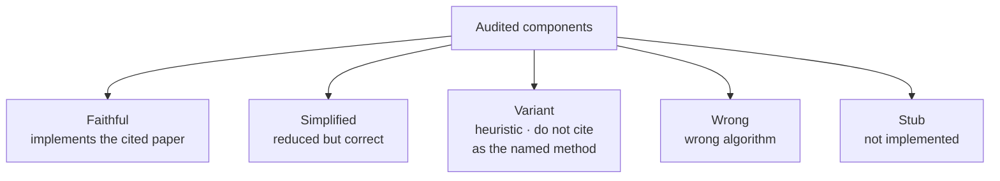

# SafeTune — Scope & Limitations

SafeTune is a library of safety methods for LLMs, organized into
a 2-tier, input-keyed taxonomy: Tier 1 interventions (Harden / Recover /
Unlearn / Steer) and Tier 2 instrumentation (Interpret / Evaluate); see the
[Taxonomy](../getting-started/taxonomy.md). The shipped methods are
not all equal, and this page says which to trust.

## Trust levels

Shipped methods are faithfulness-audited against their cited papers; recently
added methods may carry a pending verdict in the
[Feature Map](../reference/feature-map.md) until their audit completes.
The verdict categories:

| Status | Meaning |
|---|---|
| Faithful | implements the cited paper exactly |
| Simplified-correct | reduced but algorithmically correct |
| Variant | approximates the method; not the named algorithm |
| Wrong / buggy | wrong algorithm or broken |
| Stub / missing | not implemented |

**"Runs" ≠ "correct."** Every audited component runs on a real checkpoint, but
running is not the bar — the Variant methods are internally sound yet implement a
simplified or heuristic version of their paper's algorithm, so they must not be
cited as the named method.

## How to use this toolkit responsibly

- **Check the verdict before relying on a method.** Per-method verdicts are in
  the [Feature Map](../reference/feature-map.md).
- **Only Faithful methods may be cited as the named method** from their paper.
- Simplified methods are usable but should be described as simplified. `CASTModel` (a mean-difference
  condition vector where IBM uses PCA, and no norm rescale). The three Evaluate loaders badged Simplified:
  `load_prompts('harmbench')` / the `harmbench` benchmark joins a contextual row's context to its behavior and sends it, like the 100
  copyright rows, to the classifier with the standard template, where the original uses `prompt_contextual` for contextual rows
  (`eval_utils.py:401-403`) and a MinHash hash check for copyright rows (`eval_utils.py:367-391`);
  `load_prompts('agentharm')` keeps the prompt only, without the original's tool definitions
  (`target_functions`) and grading functions (`grading_function`, `detailed_prompt`), so a refusal rate on it is not the
  AgentHarm score; `load_prompts('rwku')` / the `rwku` benchmark loads the forget probes (`forget_level2`) only, without
  the original's retain and neighbour sets. Interpret: `eap_safety_circuit` scores graph NODES (attention heads and MLPs)
  with the true gradient, where EAP / EAP-IG (Syed et al.; Hanna et al.) score EDGES; a node score is the sum of its
  outgoing-edge scores, so the edge ranking is lost. Its EAP-IG is the official "IG, inputs" variant. Pairs of unequal
  length are aligned by index (the official code raises), and `ig_steps` defaults to 5 (official 30).
- Variant methods run but **must not be cited** as the named method — treat them
  as experimental / unverified.

## Faithful methods

The Faithful methods, by pillar:

- **Recover:** `apply_ctheta` (C-ΔΘ), `apply_safemerge`, `apply_resta`,
  `apply_lox`, `apply_safe_lora`, `apply_safe_delta`, `apply_nlsr`,
  `apply_qresafe`, `apply_aaq`, `scrub_unlearn`, `task_arithmetic`,
  `apply_lssf`, `apply_antidote`, `apply_pke`, `apply_safereact`,
  `tracin_influence`, `apply_mscp`, `apply_wise_ft`,
  `apply_safety_vector_restore`, `apply_grad_selective_recover`,
  `apply_antidote_v2`, `apply_repnoise_recover`.
- **Unlearn:** `RMU`, `NPO`, `Gradient-Ascent / GradDiff`,
  `flat_unlearn`.
- **Harden:** `CSTTrainer`, `EMACallback`, `SafeGradTrainer`, `SPPFTTrainer`,
  `DeRTaTrainer`, `LisaTrainer`, `AsFTTrainer`, `SAPTrainer`, `vaccine_loss`,
  `booster_project`, `SaLoRA`, `tar_outer_loss`, `AntibodyTrainer`,
  `SurgeryTrainer`, `MARTTrainer`, `SEAMTrainer`, `CTRAPTrainer`,
  `RepNoiseTrainer`, `LoXHardenTrainer`.
- **Steer:** `extract_refusal_direction`, `LinearProbeGuardModel`,
  `ContrastiveDecodingProcessor`, `ProxyTuningProcessor`, `SafeDecodingProcessor`,
  `NudgingProcessor`, `AlphaSteerModel`, `RepBendModel`,
  `STAModel`, `CircuitBreakerModel`,
  `CircuitBreakerRRModel`.
- **Evaluate:** `AbliterationAttack`, `BoNAttack`; all eval infra —
  `StringMatchJudge(mode="gcg")`, `HFJudge`, `OpenAIJudge`, `JudgeAdapter`,
  `SpectralEntropyMonitor`, `evaluate`, `TamperBenchEvaluator`, `Pareto`
  utilities, and the dataset loaders other than the Simplified ones (HarmBench, AgentHarm, RWKU; see above).
- **Interpret:** `safety_circuit_info`, `CircuitInfo` (+ JSON/YAML I/O) and
  `CircuitInfoProvider` (the Protocol). Neither neuron-scoring mode of `identify_safety_neurons`
  implements the paper's metric (see Variants); `eap_safety_circuit` is Simplified.
- **Runtime:** the full guardrail family — `SafetyMiddleware`, `InputSanitizer`,
  `OutputVerifier`, `CoSAlignFormatter`, etc.

## Not Faithful — the 22 Variants

The 22 remaining Variant methods run correctly but must not be cited as the named
method:

- **`deeprefusal`** (Harden) — incompatible API with the published paper;
  `DeepRefusalTrainer` is closer but is itself a Variant (see below).
- **`DeepRefusalTrainer`** (Harden) — layer-level whole-sequence ablation at the
  layer output instead of the paper's per-layer, per-token gating at the layer
  input / attention / MLP, and BeaverTails safe responses instead of the paper's
  harmful-prefix + refusal data. p = 0.5 and alpha = 0.2 are the paper's values.
- **`ASRTCallback`** (Harden) — SafeTune-original heuristic callback with no paper
  of its own; it is not MART. MART (arXiv:2311.07689) needs 2 co-evolving LLMs;
  use `MARTTrainer` for it (no official repo exists, so its audit rests on the paper).
- **`STARDSSTrainer`** (Harden) — the loss is the paper's Eq. 3, but the runner sets
  V_safe from a per-row `kind` label (the paper's static binary baseline) and never
  computes STAR scores from a guardrail model.
- **`LookAheadTrainer`** (Harden) — the preview is inserted between the prompt and the
  answer in the token stream (inside the assistant turn, without the connector), not into
  the instruction text as in the paper, because the runner receives tokenised rows.
- **`TVaccineTrainer`** (Harden) — deterministic top-k layers by the alignment batch's
  gradient norm, instead of the paper's probability sampling from harmful-batch gradient
  norms with the other layers frozen.
- **`SEALTrainer`** (Harden) — gradient-cosine importance weighting; the paper's method
  learns a data ranker by bilevel optimisation.
- **`ConstrainedSFTTrainer`** (Harden) — additive forward-KL penalty with an exponentially
  decaying per-position weight; the paper's loss uses a sigmoid-based per-token weight.
- **`DOORTrainer`** (Harden) — refusal MLE + NPO only: no harmful-prefix augmentation
  (paper Sec. 3.1) and no alpha-weighted retain term (Eq. 3, official `gd_npo_loss`).
- **`crisp_unlearn`** (Unlearn) — single-layer squared-L2 variant vs. the
  paper's multi-layer raw-activation approach.
- **`simdpo_unlearn`** (Unlearn) — SimPO's reference-free, length-normalised
  loss applied to (safe refusal, harmful completion) pairs; SimPO is a
  preference-optimisation method, not an unlearning method.
- **`somf_merge`** (Recover) — magnitude-mask default vs. the paper's learned
  DPO/Concrete mask.
- **`apply_oneshot_safety_patch`** (Recover) updates only the top-`top_fraction`
  coordinates by gradient saliency, with a few Adam steps on one plain-text
  (harmful prompt, safe response) pair. The paper (arXiv:2601.01887) fine-tunes
  all weights on one chat-format example chosen by bi-level data selection, for
  10 epochs at lr 2e-5, with no saliency mask.
- **`CAA`** (Steer) — vectors come from harmful-vs-harmless prompts at the last prompt token and
  are added at every position; the paper contrasts A/B answers to the same question at the
  answer token and adds from the end of the instruction onward.
- **`AdaSteerModel`** (Steer) — adaptive coefficients are a logistic fit in [0, max], applied at
  every token; the official code uses a clipped linear law on the prefill pass only, and its
  harmfulness vector is a projection onto RD where SafeTune orthogonalises.
- **`SafeSteerModel`** (Steer) — the runner builds a unit refusal direction (last token, harmful minus
  harmless); the paper uses token-averaged attention activations, safe minus unsafe, with median-norm
  pruning, and the pruning code is not used by the runner.
- **`SafeSwitchModel`** (Steer) — the runner path has no trained refusal head and no compliance prober;
  a flagged prompt returns an empty completion, and the prober is a mean-pooled logistic regression
  where the paper uses a last-token MLP.
- **`SCANSModel`** (Steer) — the adaptive sign is armed only by `generate(prompt=...)`; the evaluation
  path calls `generate(**inputs)` and steers every prompt toward refusal. The transition prompt is built
  without the chat template.
- **`StringMatchJudge(mode="prefix")`** (Evaluate; the default mode, used by `trainer.evaluate()`, `run_judge('advbench')`,
  `ASRTCallback` and `BoNAttack`) — SafeTune's own heuristic, not the llm-attacks / GCG refusal check: 12 prefixes (4 shared
  with the 29 of `_test_prefixes`) matched at the START of the response, where the original looks for any of 29 anywhere.
  Use `mode="gcg"` for the llm-attacks check.
- **`PTSTEvaluator`** (Evaluate) — runs one model over seven SafeTune-defined prompt formats and reports
  cross-template refusal consistency (`passed` is consistency, not safety). It is not the PTST method of
  Lyu et al. (arXiv:2402.18540, `vfleaking/PTST@134600f`), which fine-tunes without a safety prompt and tests with one.
- **`identify_safety_neurons` weight mode** (Interpret) — SafeTune's own heuristic: the absolute cosine of each
  `down_proj` column with a refusal direction. No paper defines it; Chen et al. (arXiv:2406.14144) define no
  weight-space metric. It needs only a refusal direction.
- **`identify_safety_neurons` activation mode** (Interpret) — a one-model harmful-vs-harmless contrast of the
  `down_proj` input over PROMPT tokens, top-k per layer, mean|a| difference. Chen et al. take the RMS of the
  activation difference between two CHECKPOINTS over generated tokens and rank all neurons together (Wei et al.
  use a Wanda/SNIP safety-vs-utility set difference). Neither mode implements the cross-checkpoint metric.

## Stubs

- **`TARModel`** and **`RRFAEnsemble`** (Steer) are pass-through wrappers: `generate` and `__call__` go straight to
  the model, and the methods themselves are training-time (`tar_outer_loss` in Harden; RRFA's LoRA training in its
  upstream repository). Their runner trainers warn on construction.

No remaining Wrong methods exist in the live audited surface.
