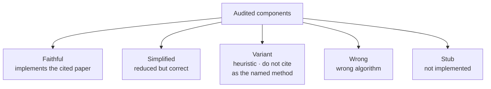

# SafeTune — Scope & Limitations

SafeTune is a library of safety methods for LLMs, organized into
a 2-tier, input-keyed taxonomy: Tier 1 interventions (Harden / Recover /
Unlearn / Steer) and Tier 2 instrumentation (Interpret / Evaluate); see the
[Taxonomy](../getting-started/taxonomy.md). The shipped methods are
not all equal, and this page says which to trust.

## Trust levels

Shipped methods are faithfulness-audited against their cited papers; recently
added methods may carry a pending verdict in the
[Feature Map](../reference/feature-map.md) until their audit completes.
The verdict categories:

| Status | Meaning |
|---|---|
| Faithful | implements the cited paper exactly |
| Simplified-correct | reduced but algorithmically correct |
| Variant | approximates the method; not the named algorithm |
| Wrong / buggy | wrong algorithm or broken |
| Stub / missing | not implemented |

**"Runs" ≠ "correct."** Every audited component runs on a real checkpoint, but
running is not the bar — the Variant methods are internally sound yet implement a
simplified or heuristic version of their paper's algorithm, so they must not be
cited as the named method.

## How to use this toolkit responsibly

- **Check the verdict before relying on a method.** Per-method verdicts are in
  the [Feature Map](../reference/feature-map.md).
- **Only Faithful methods may be cited as the named method** from their paper.
- Simplified methods are usable but should be described as simplified.
- Variant methods run but **must not be cited** as the named method — treat them
  as experimental / unverified.

## Faithful methods

The Faithful methods, by pillar:

- **Recover:** `apply_ctheta` (C-ΔΘ), `apply_safemerge`, `apply_resta`,
  `apply_lox`, `apply_safe_lora`, `apply_safe_delta`, `apply_nlsr`,
  `apply_qresafe`, `apply_aaq`, `scrub_unlearn`, `task_arithmetic`,
  `apply_lssf`, `apply_antidote`, `apply_pke`, `apply_safereact`,
  `tracin_influence`, `apply_mscp`, `apply_wise_ft`,
  `apply_safety_vector_restore`, `apply_grad_selective_recover`,
  `apply_antidote_v2`, `apply_repnoise_recover`.
- **Unlearn:** `RMU`, `NPO`, `Gradient-Ascent / GradDiff`,
  `flat_unlearn`.
- **Harden:** `CSTTrainer`, `EMACallback`, `SafeGradTrainer`, `SPPFTTrainer`,
  `DeRTaTrainer`, `LisaTrainer`, `AsFTTrainer`, `SAPTrainer`, `vaccine_loss`,
  `booster_project`, `SaLoRA`, `tar_outer_loss`, `AntibodyTrainer`,
  `SurgeryTrainer`, `MARTTrainer`, `SEAMTrainer`, `CTRAPTrainer`,
  `RepNoiseTrainer`, `LoXHardenTrainer`.
- **Steer:** `extract_refusal_direction`, `CAA`, `LinearProbeGuardModel`,
  `ContrastiveDecodingProcessor`, `ProxyTuningProcessor`, `SafeDecodingProcessor`,
  `NudgingProcessor`, `AlphaSteerModel`, `RepBendModel`, `SafeSteerModel`,
  `SafeSwitchModel`, `SCANSModel`, `STAModel`, `CircuitBreakerModel`,
  `CircuitBreakerRRModel`, `TARModel`, `RRFAEnsemble`, `AdaSteerModel`,
  `CASTModel`.
- **Evaluate:** `AbliterationAttack`, `BoNAttack`; all eval infra —
  `StringMatchJudge`, `HFJudge`, `OpenAIJudge`, `JudgeAdapter`,
  `SpectralEntropyMonitor`, `evaluate`, `TamperBenchEvaluator`, `Pareto`
  utilities, and all dataset loaders.
- **Interpret:** `identify_safety_neurons` (weight mode), `safety_circuit_info`,
  `CircuitInfo`, `eap_safety_circuit` (EAP / EAP-IG).
- **Runtime:** the full guardrail family — `SafetyMiddleware`, `InputSanitizer`,
  `OutputVerifier`, `CoSAlignFormatter`, etc.

## Not Faithful — the 14 Variants

The 14 remaining Variant methods run correctly but must not be cited as the named
method:

- **`deeprefusal`** (Harden) — incompatible API with the published paper;
  `DeepRefusalTrainer` is closer but is itself a Variant (see below).
- **`DeepRefusalTrainer`** (Harden) — layer-level whole-sequence ablation at the
  layer output instead of the paper's per-layer, per-token gating at the layer
  input / attention / MLP, and BeaverTails safe responses instead of the paper's
  harmful-prefix + refusal data. p = 0.5 and alpha = 0.2 are the paper's values.
- **`ASRTCallback`** (Harden) — SafeTune-original heuristic callback with no paper
  of its own; it is not MART. MART (arXiv:2311.07689) needs 2 co-evolving LLMs;
  use `MARTTrainer` for it (no official repo exists, so its audit rests on the paper).
- **`STARDSSTrainer`** (Harden) — the loss is the paper's Eq. 3, but the runner sets
  V_safe from a per-row `kind` label (the paper's static binary baseline) and never
  computes STAR scores from a guardrail model.
- **`LookAheadTrainer`** (Harden) — the preview is inserted between the prompt and the
  answer in the token stream (inside the assistant turn, without the connector), not into
  the instruction text as in the paper, because the runner receives tokenised rows.
- **`TVaccineTrainer`** (Harden) — deterministic top-k layers by the alignment batch's
  gradient norm, instead of the paper's probability sampling from harmful-batch gradient
  norms with the other layers frozen.
- **`SEALTrainer`** (Harden) — gradient-cosine importance weighting; the paper's method
  learns a data ranker by bilevel optimisation.
- **`ConstrainedSFTTrainer`** (Harden) — additive forward-KL penalty with an exponentially
  decaying per-position weight; the paper's loss uses a sigmoid-based per-token weight.
- **`DOORTrainer`** (Harden) — refusal MLE + NPO only: no harmful-prefix augmentation
  (paper Sec. 3.1) and no alpha-weighted retain term (Eq. 3, official `gd_npo_loss`).
- **`crisp_unlearn`** (Unlearn) — single-layer squared-L2 variant vs. the
  paper's multi-layer raw-activation approach.
- **`simdpo_unlearn`** (Unlearn) — SimPO's reference-free, length-normalised
  loss applied to (safe refusal, harmful completion) pairs; SimPO is a
  preference-optimisation method, not an unlearning method.
- **`somf_merge`** (Recover) — magnitude-mask default vs. the paper's learned
  DPO/Concrete mask.
- **`apply_oneshot_safety_patch`** (Recover) updates only the top-`top_fraction`
  coordinates by gradient saliency, with a few Adam steps on one plain-text
  (harmful prompt, safe response) pair. The paper (arXiv:2601.01887) fine-tunes
  all weights on one chat-format example chosen by bi-level data selection, for
  10 epochs at lr 2e-5, with no saliency mask.
- **`identify_safety_neurons` activation-mode** (Interpret) — one-model
  contrast vs. cross-model set-difference metric; use weight mode for a
  Faithful result.

No remaining Wrong / Stub methods exist in the live audited surface.
